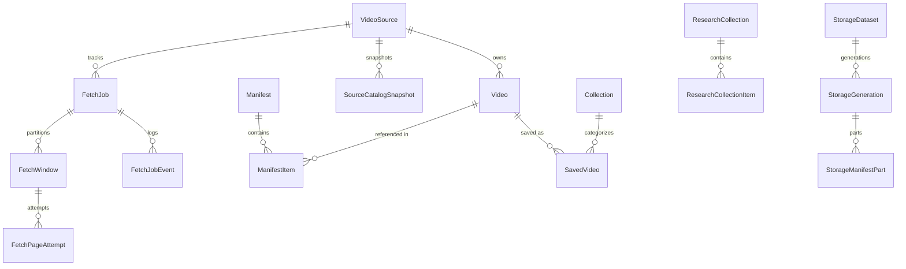

# Database Architecture — Dailymotion Discovery (2026)

This document describes the canonical database architecture for the **Dailymotion Discovery Platform**, powered by **Prisma ORM 7 (`7.10.1`)** and hosted on **Supabase PostgreSQL** via the Supabase Session Pooler (`aws-0-eu-west-2.pooler.supabase.com:5432`).

---

## 1. Architectural Principles & Single-Truth Policy

1. **Prisma ORM 7 (`7.10.1`) Canonical Source of Truth**:
   The entire data layer is modeled in `prisma/schema.prisma` and managed through standard SQL migrations in `prisma/migrations/`. No experimental or unversioned database layers exist.
2. **Zero Plaintext / Direct Password Storage in PostgreSQL**:
   Administrator authentication is handled exclusively by **Supabase Auth**. PostgreSQL stores zero user passwords, salts, or direct password hashes.
3. **Forward-Only, Non-Destructive Migrations**:
   All migrations are additive and applied sequentially without table resets, data loss, or destructive drops.
4. **Owner-Scoped Data Boundaries**:
   All persistence entities (`saved_videos`, `collections`, `saved_search_presets`, `storage_datasets`, etc.) are tagged with `storage_owner_uuid` or `user_id` to ensure strict tenant and owner isolation.
5. **Session Pooler IPv4 Routing**:
   Connections are established through `DATABASE_URL` targeting the Supabase Transaction/Session Pooler over IPv4 on port 5432.

---

## 2. Canonical Database Tables (23 Tables in `public` Schema)

| Table Name | Prisma Model | Primary Purpose | Key Indexes & Constraints |
|---|---|---|---|
| `_prisma_migrations` | System | Migration tracking table maintained by Prisma Migrate | `PRIMARY KEY (id)` |
| `video_sources` | `VideoSource` | Tracked Dailymotion channels, playlists, users, and queries | `UNIQUE (platform, platform_source_id)` |
| `videos` | `Video` | Normalized video catalog items discovered from Dailymotion | `UNIQUE (platform, platform_video_id)` |
| `manifests` | `Manifest` | Historical and durable discovery manifest runs | `INDEX (manifest_type, persistence_type)` |
| `manifest_items` | `ManifestItem` | Association table between manifests and videos | `UNIQUE (manifest_id, video_id)` |
| `fetch_jobs` | `FetchJob` | Channel deep fetch job orchestrator and checkpoint ledger | `INDEX (source_id, status)` |
| `fetch_windows` | `FetchWindow` | Partitioned date and sequence windows for channel crawling | `INDEX (job_id, status)` |
| `fetch_page_attempts` | `FetchPageAttempt` | Individual HTTP page fetch attempts with retry metrics | `INDEX (window_id, attempt_number)` |
| `source_catalog_snapshots` | `SourceCatalogSnapshot` | Point-in-time catalog statistics and coverage analysis | `INDEX (source_id, created_at)` |
| `fetch_job_events` | `FetchJobEvent` | Audit trail and timeline log events for deep fetch jobs | `INDEX (job_id, created_at)` |
| `collections` | `Collection` | User-defined organization folders for saved videos | `INDEX (name)` |
| `saved_videos` | `SavedVideo` | Persisted bookmarked videos with user tags, notes, and order | `UNIQUE (video_id)` |
| `api_version_token_caches` | `ApiVersionTokenCache` | Server-cached OAuth tokens for Dailymotion V1/V2 APIs | `UNIQUE (cache_key)` |
| `search_histories` | `SearchHistory` | Cloud-persisted search query history and filter snapshots | `INDEX (created_at)` |
| `batch_commits` | `BatchCommit` | Two-phase commit ledger for cloud workspace sync | `UNIQUE (batch_id)` |
| `data_migration_runs` | `DataMigrationRun` | Audited data migration and schema transition logs | `UNIQUE (migration_name)` |
| `storage_documents` | `StorageDocument` | Metadata pointers to raw JSON snapshots and archives | `UNIQUE (storage_path)` |
| `saved_search_presets` | `SavedSearchPreset` | Search presets with taxonomy, API/local filters, and query | `UNIQUE (owner_id, name)` |
| `research_collections` | `ResearchCollection` | Research workspace collections supporting multi-resource items | `INDEX (owner_id)` |
| `research_collection_items` | `ResearchCollectionItem` | Items assigned to research collections with stable IDs | `UNIQUE (collection_id, stable_id)` |
| `storage_datasets` | `StorageDataset` | Cloudflare R2 dataset registry (`saved-items`, etc.) | `UNIQUE (owner_id, slug)` |
| `storage_generations` | `StorageGeneration` | Immutable dataset generation manifests stored in R2 | `UNIQUE (dataset_id, generation_id)` |
| `storage_manifest_parts` | `StorageManifestPart` | Partitioned chunk records with SHA-256 checksums | `UNIQUE (generation_id, part_number)` |

---

## 3. Core Entity-Relationship Diagram

---

## 4. Key Lifecycle State Enums

### Manifest Status (`manifest_status`)
- `DRAFT`: Newly created manifest before fetch execution.
- `FETCHING`: Actively fetching items from Dailymotion API.
- `PARTIAL`: Completed with some pages or windows missing.
- `COMPLETE`: Fully fetched catalog matching provider count.
- `CAPPED`: Reached configured maximum fetch boundaries.
- `STOPPED`: Manually cancelled or paused by operator.
- `FAILED`: Unrecoverable network or provider failure.
- `EXPIRED`: Past TTL cleanup horizon.

### Fetch Job Status (`fetch_job_status`)
- `PENDING` -> `RUNNING` -> `COMPLETE` / `PARTIAL` / `CAPPED` / `FAILED` / `MAX_ITEMS_REACHED` / `TIMEOUT_LIMITED` / `PROVIDER_LIMITED`.

### Coverage Status & Confidence (`coverage_status`, `coverage_confidence`)
- `coverage_status`: `UNKNOWN`, `PARTIAL`, `COMPLETE`, `CAPPED`, `FAILED`, `STOPPED`, `PROVIDER_LIMITED`.
- `coverage_confidence`: `HIGH`, `MEDIUM`, `LOW`.

---

## 5. Storage & Persistence Mapping

1. **Structured Relational Truth (PostgreSQL)**:
   - High-frequency query filters, pagination, collections, attempt histories, and foreign key relations live in PostgreSQL.
2. **Binary & Document Manifest Truth (Cloudflare R2)**:
   - Bulk item manifests, partitioned JSON parts, and generation archives live in **Cloudflare R2** (`dailymotion-discovery-private`), tracked by `storage_datasets`, `storage_generations`, and `storage_manifest_parts`.
3. **Local-First Client Cache (IndexedDB)**:
   - Browser client keeps local copy in `dailymotion_discovery_local_v1` IndexedDB database with two-phase synchronization via `SyncCoordinator`.
