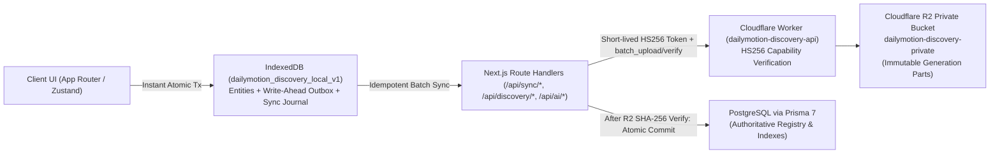

# Dailymotion Discovery — Target Architecture (2026)

- **Document:** `docs/architecture/dailymotion-target-architecture.md`
- **Date:** 2026-11-12
- **Stack:** Next.js 16.4.6 App Router · React 19 · TypeScript · Prisma ORM 7.10.1 (`@prisma/adapter-pg`) · PostgreSQL (Supabase) · Cloudflare Worker (`dailymotion-discovery-api`) + Cloudflare R2 (`dailymotion-discovery-private`) · IndexedDB · `@google/genai` (`gemini-2.5-flash`)

---

## 1. Authority & Storage Ownership Boundaries

1. **Pending Local Truth -> IndexedDB (`dailymotion_discovery_local_v1`)**:
   - Every user edit (save item, add/reorder/remove collection item, collection notes, saved search preset, search history snapshot) commits atomically to IndexedDB **and** appends a `PENDING` entry to `pending_operations` in the same transaction.
   - Outbox operations are **never** pruned until the Next.js server confirms R2 verification **and** PostgreSQL commit (`CLOUD_COMMITTED` receipt).
2. **Authoritative Cloud Registry -> PostgreSQL (Prisma 7)**:
   - Relational models (`Video`, `Collection`, `SavedVideo`, `SearchHistory`, `SavedSearchPreset`, `BatchCommit`, `StorageDataset`, `StorageGeneration`, `StorageManifestPart`) hold the active committed revision, active `currentGenerationId`, and relational query/order truth.
3. **Authoritative Immutable Snapshot Storage -> Cloudflare R2 (`dailymotion-discovery-private`)**:
   - Accessed **only** through the dedicated Worker `dailymotion-discovery-api` using short-lived server-signed HS256 capability tokens (`iss: "dailymotion-discovery-web"`, `aud: "dailymotion-discovery-api"`).
   - Never shares Workers, secrets, or buckets with YouTube Discovery.
   - Immutable generation layout:
     - `dailymotion/persistence/<ownerId>/<datasetSlug>/generations/<generationId>/parts/part-000001.json`
     - `dailymotion/persistence/<ownerId>/<datasetSlug>/generations/<generationId>/manifest.json`
     - `dailymotion/persistence/<ownerId>/<datasetSlug>/version.json`
   - Commit order rule: Upload parts -> Verify SHA-256 & byte lengths via Worker `batch_verify` -> Commit PostgreSQL generation/dataset/domain rows in `prisma.$transaction` -> Best-effort update `version.json` pointer.

---

## 2. Discovery API & Dual Filter Separation

1. **Strict V1 vs V2 Adapters**:
   - `v1-client.ts` / `v1-search-service.ts` / `v1-normalize.ts`: `https://api.dailymotion.com` (public anonymous discovery) and `https://partner.api.dailymotion.com/rest` (`client_credentials`), Unix timestamps, `channel` categories, `limit`/`page`, `id`.
   - `v2-client.ts` / `v2-search-service.ts` / `v2-normalize.ts`: `https://api.dailymotion.com/v2` + `oauth2.dailymotion.com/v2/token` (`bundle.public` default), ISO-8601 `created_at`, `page_size` + `next` cursor, `video_id`/`profile_id`/`playlist_id`/`livestream_id`, profile-scoped listings only.
2. **Unified `FilterCapability` Matrix (`src/lib/discovery/filter-capabilities.ts`)**:
   - Every filter key declares `{ key, label, category, support: "api" | "local" | "unsupported", versions, resources, notes }`.
   - Separate state contracts in Search UIs:
     - `ProviderSearchState` (`version`, `resource`, `mode`, `query`, `profileId`, `apiParams`, `sort`, `pageSize`, `fields`)
     - `LocalFilterState` (`includeText`, `excludeKeywords`, `exactPhrase`, `targetFields`, `resourceTypes`, `minViews`, `maxViews`, `minDurationSec`, `maxDurationSec`, `dateFrom`, `dateTo`, `language`, `category`, `explicitFilter`, `kidsFilter`, `hasThumbnail`, `hasDescription`, `strictMetadata`, `localSort`)
     - `ResultViewState` (`items`, `filteredItems`, `selectedIds`, `activeTab`, `inspectedItem`, `meta`)
   - Changing any `LocalFilterState` control re-filters/sorts loaded results immediately via `src/lib/filters/discovery-result-filters.ts` with zero extra API requests.

---

## 3. Worker Security Model (`cloudflare/workers/dailymotion-discovery-api`)

- Native Cloudflare R2 binding (`env.R2_BUCKET -> dailymotion-discovery-private`). Zero S3 SDKs or AWS keys.
- Every request (except `GET /health`) requires `Authorization: Bearer <HS256 capability token>` verified via Web Crypto HMAC-SHA256.
- Claims validate `iss`, `aud === "dailymotion-discovery-api"`, `exp > now`, `operation`, `storage_owner_uuid`, and `key`/`prefix` containment.
- Path sanitizer blocks `..`, `\`, control characters, and keys outside `dailymotion/(persistence|temp)/<owner>/...`.
- Size ceilings: `45 MiB` max single object, `200 MiB` max batch, `50` items max per batch, JSON content-type enforcement (`application/json`).
- Immutable part writes reject overwrite (`onlyIf` / `409 Conflict` if part exists) unless `version.json` or derived convenience `manifest.json` explicitly permits update.

---

## 4. Non-Destructive Supabase Private Storage Migration Plan

Existing Dailymotion Discovery batches may have snapshots in Supabase Private Storage (`application-data` bucket tracked in `storage_documents`). **Nothing in Supabase Storage is ever deleted automatically.**

1. **Inventory**: Inspect `storage_documents` rows and compare checksums against Postgres `BatchCommit`, `SavedVideo`, and `SearchHistory` records.
2. **Coexistence Read Adapter**:
   - New saves write immutable generations to Cloudflare R2 (via Worker) when configured (with optional dual/local fallback only in unconfigured dev).
   - Historical `StorageDocument` paths in Supabase Storage remain readable read-only for recovery/verification/migration preview via `/api/admin/storage-migration`.
3. **Verify & Promote**: Exported migration plans copy Supabase envelopes into canonical immutable R2 generations (`dailymotion/persistence/<owner>/legacy-supabase-archive/...`), verify SHA-256 & item counts, record a `DataMigrationRun` checkpoint, and keep original Supabase Storage objects intact until manual operator decommission.
